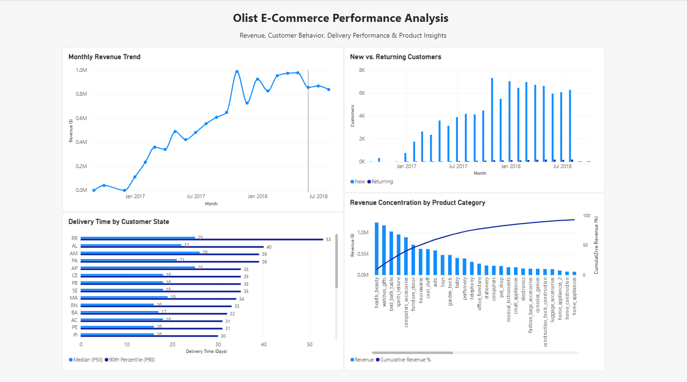

# Olist E-Commerce SQL Analysis

## Overview

This project analyzes the Olist Brazilian E-Commerce dataset using MySQL to explore marketplace performance across revenue, delivery operations, customer behavior, seller performance, and product categories.

The project follows an end-to-end analytics workflow: designing a relational database, loading and validating raw data, answering business questions with SQL, documenting key findings, and visualizing selected insights in Power BI.

The analysis covers approximately 100,000 orders placed between 2016 and 2018.

---

## Business Questions

The analysis focuses on four primary areas:

### Revenue & Demand
- How has marketplace revenue changed over time?
- Which product categories and customer states generate the most revenue?
- How concentrated is revenue across categories and sellers?

### Delivery Performance
- How long do orders take to reach customers?
- Which states experience the longest delivery times?
- How frequently do orders arrive after their estimated delivery date?
- How is delivery performance associated with customer reviews?

### Customer Behavior
- How many customers return after their first purchase?
- How does retention change across acquisition cohorts?
- Which customers appear most valuable based on recency, frequency, and monetary value?

### Seller & Product Performance
- Which sellers contribute the most marketplace revenue?
- How can sellers be compared across revenue, reviews, delivery time, and cancellations?
- Which product categories are frequently purchased together?

---

## Tools & Technologies

- **MySQL 8.0** — database creation, data cleaning, validation, and analysis
- **MySQL Workbench** — database management and query development
- **Power BI Desktop** — dashboard development and visualization
- **SQL** — joins, aggregations, CTEs, window functions, subqueries, views, and performance analysis
- **Git & GitHub** — version control and project documentation

---

## Data Model

The analysis uses the following primary Olist tables:

- `customers`
- `orders`
- `order_items`
- `order_payments`
- `order_reviews`
- `products`
- `sellers`
- `category_translation`
- `geolocation`

The central analytical table is `orders`, which connects customer activity to order items, payments, and reviews.

Special attention was given to table grain. Because `order_items`, `order_payments`, and `order_reviews` can each contain multiple records per order, child tables were pre-aggregated when necessary to prevent row multiplication and inflated metrics.

See [`docs/data_dictionary.md`](docs/data_dictionary.md) for detailed table and column definitions.

---

## Data Validation & Cleaning

Before beginning the analysis, I performed validation checks to better understand the dataset and establish consistent analytical rules.

Key checks included:

- Validating row counts after loading the CSV files
- Checking for duplicate order IDs
- Checking for orphaned foreign-key records
- Auditing missing delivery timestamps
- Reviewing order-status distributions
- Checking the available date range
- Identifying orders with multiple reviews
- Checking for nonpositive prices and unusual freight values
- Validating review scores

### Key Data Decisions

- Revenue and delivery analyses primarily use **delivered orders**.
- Eight delivered orders missing an actual delivery timestamp were excluded from delivery-time calculations.
- Customer-level analysis uses `customer_unique_id` rather than `customer_id` when identifying repeat customers.
- Multiple-review behavior was considered when interpreting review-based analyses.
- Early and late months with limited data were treated cautiously when interpreting time trends.

---

## SQL Analysis

The analysis was organized into three tiers of increasing complexity.

### Tier 1 — Foundations

Explored core marketplace metrics including:

- Order and customer counts
- Order-status distribution
- Monthly revenue
- Revenue by product category
- Average order value
- Items per order
- Payment-method mix
- Revenue by customer state
- Review-score distribution

### Tier 2 — Intermediate Analysis

Expanded the analysis to include:

- Month-over-month revenue growth
- Delivery time by state
- On-time vs. late delivery rates
- Delivery performance vs. review scores
- Seller revenue concentration
- Freight cost analysis
- Review scores by category
- Installments vs. order value

### Tier 3 — Advanced Analysis

Used more advanced SQL techniques for:

- New vs. returning customer analysis
- Cohort retention
- Cumulative revenue
- Top product categories by state
- RFM customer segmentation
- Multi-metric seller scorecards
- Median and 90th-percentile delivery times
- Revenue Pareto analysis
- Product-category affinity analysis

---

## Key Findings

### 1. Marketplace revenue grew substantially

Cumulative delivered-order revenue reached approximately **$13.22 million** by August 2018.

November 2017 experienced particularly strong growth, with monthly revenue increasing approximately **52.37% month over month**.

### 2. Revenue is concentrated across product categories

The top **17 product categories generated 80.76% of delivered-order revenue**.

Health & Beauty was the largest individual category, contributing approximately **9.45%**, while the top five categories accounted for **40.37%**.

### 3. Delivery performance varies significantly by state

Average delivery time across delivered orders was approximately **12.5 days**.

São Paulo (SP) had a median delivery time of **7 days** and a 90th-percentile delivery time of **16 days**, compared with **25 days** and **53 days** in Roraima (RR).

Overall, approximately **91.89% of delivered orders arrived on or before their estimated delivery date**.

### 4. Late deliveries are associated with lower customer ratings

On-time deliveries received an average review score of **4.29**, compared with **2.57** for late deliveries.

This represents a difference of approximately **1.72 review points**.

This relationship should be interpreted as an association rather than evidence that late delivery alone caused lower ratings.

### 5. Repeat purchasing is limited

Marketplace activity was dominated by first-time customers.

For example, May 2018 included approximately **6,622 new customers compared with 192 returning customers**.

For larger acquisition cohorts, Month 1 retention generally remained below **1%**.

### 6. Seller revenue is highly concentrated

The top **10% of sellers generated approximately 67.11% of delivered-order GMV**, representing roughly **$8.87 million** of the marketplace's $13.22 million delivered-order revenue.

### 7. RFM analysis identified a small high-value customer segment

The RFM analysis identified **1,615 Champions**.

This segment had an average frequency of approximately **1.69 orders** and average monetary value of approximately **$298.47**, the highest among the defined RFM segments.

### 8. Product-category affinity reveals cross-selling opportunities

The most common cross-category combination was:

**Bed & Bath Table + Furniture Decor — 70 orders**

Other notable combinations included:

- Bed & Bath Table + Home Comfort — 43 orders
- Furniture Decor + Housewares — 24 orders
- Baby + Toys — 19 orders
- Health & Beauty + Perfumery — 12 orders

These combinations may provide useful starting points for product recommendations, bundles, or cross-selling analysis.

For additional interpretation and analytical caveats, see [`docs/findings.md`](docs/findings.md).

---

## Power BI Dashboard

Selected SQL results were exported and visualized using Power BI Desktop.

The dashboard focuses on four areas:

- Monthly revenue trends
- New vs. returning customers
- Delivery-time variation across customer states
- Product-category revenue concentration



The Power BI report is available in:

`powerbi/olist_ecommerce_analysis.pbix`

---

## SQL Skills Demonstrated

This project demonstrates:

- `INNER JOIN` and `LEFT JOIN`
- `GROUP BY` and `HAVING`
- Common Table Expressions (`WITH`)
- Window functions
  - `LAG()`
  - `SUM() OVER()`
  - `RANK()`
  - `ROW_NUMBER()`
  - `NTILE()`
- Conditional aggregation with `CASE`
- Subqueries
- Date functions including `DATE_FORMAT()` and `DATEDIFF()`
- Cohort analysis
- RFM segmentation
- Percentile calculations
- Pareto analysis
- Market-basket/category-affinity analysis
- Reusable SQL views
- Indexing
- Query-plan inspection with `EXPLAIN`
- Pre-aggregation to prevent join fan-out

A reusable `order_revenue` view was also created to provide a consistent order-level revenue dataset across analyses.

---

## Query Performance

Indexes were added to frequently joined and filtered columns, including:

- Order customer IDs
- Purchase timestamps
- Order-item order IDs
- Product IDs
- Seller IDs
- Payment order IDs
- Review order IDs
- Product categories

`EXPLAIN` was used to inspect query execution plans.

For example, a date-filtered order analysis used the `idx_orders_purchase` index with a range scan, while the order-items join used the order-items primary key.

---

## Repository Structure

```text
olist-ecommerce-sql-analysis/
│
├── data/
│   └── README.md
│
├── docs/
│   ├── ERD.png
│   ├── data_dictionary.md
│   └── findings.md
│
├── exports/
│   ├── monthly_revenue.csv
│   ├── delivery_by_state.csv
│   ├── new_vs_returning_customers.csv
│   └── category_revenue_pareto.csv
│
├── images/
│   └── olist_powerbi_dashboard.png
│
├── powerbi/
│   └── olist_ecommerce_analysis.pbix
│
├── sql/
│   ├── views/
│   │   └── 01_order_revenue_view.sql
│   ├── 01_schema_ddl.sql
│   ├── 02_load_data.sql
│   ├── 03_data_cleaning_checks.sql
│   ├── 04_analysis_tier1.sql
│   ├── 05_analysis_tier2.sql
│   └── 06_analysis_tier3.sql
│
├── .gitignore
└── README.md
```

---

## How to Reproduce the Analysis

1. Download the Olist Brazilian E-Commerce dataset.
2. Create a MySQL database named `olist`.
3. Run `sql/01_schema_ddl.sql` to create the database tables and indexes.
4. Update the local file paths in `sql/02_load_data.sql` to match the location of the CSV files on your computer.
5. Run `sql/02_load_data.sql` to load the dataset.
6. Run `sql/03_data_cleaning_checks.sql` to validate the loaded data.
7. Run the analysis files in order:
   - `04_analysis_tier1.sql`
   - `05_analysis_tier2.sql`
   - `06_analysis_tier3.sql`
8. Optionally create the reusable view in `sql/views/01_order_revenue_view.sql`.
9. Open `powerbi/olist_ecommerce_analysis.pbix` to view the Power BI dashboard.

---

## Dataset

This project uses the **Brazilian E-Commerce Public Dataset by Olist**, which contains anonymized marketplace order data from Brazil.

Raw CSV files are not included in this repository and are excluded through `.gitignore`.

---

## Author

**Aastha Gautam**

Data Analytics | SQL | Power BI